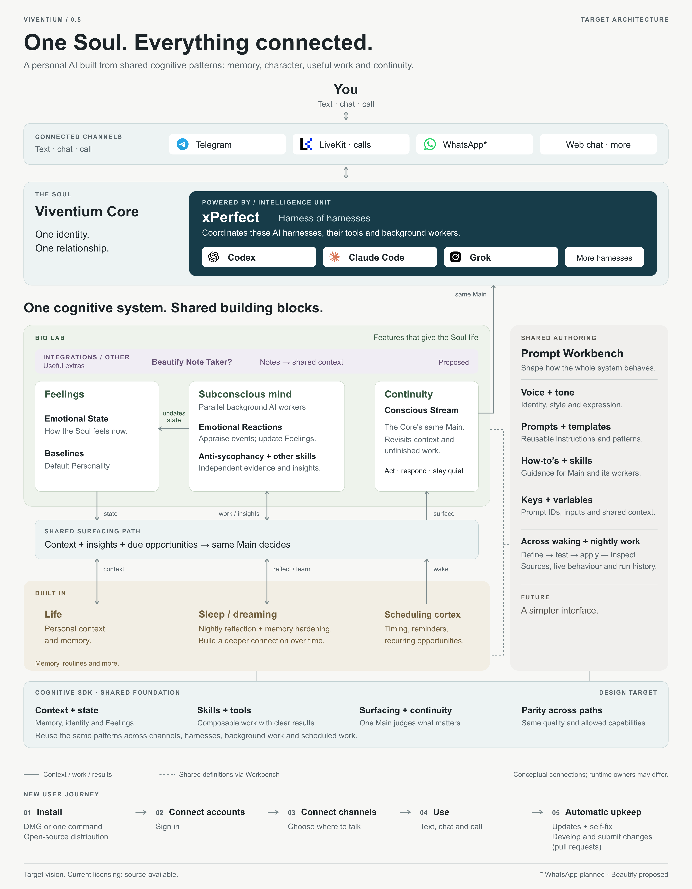
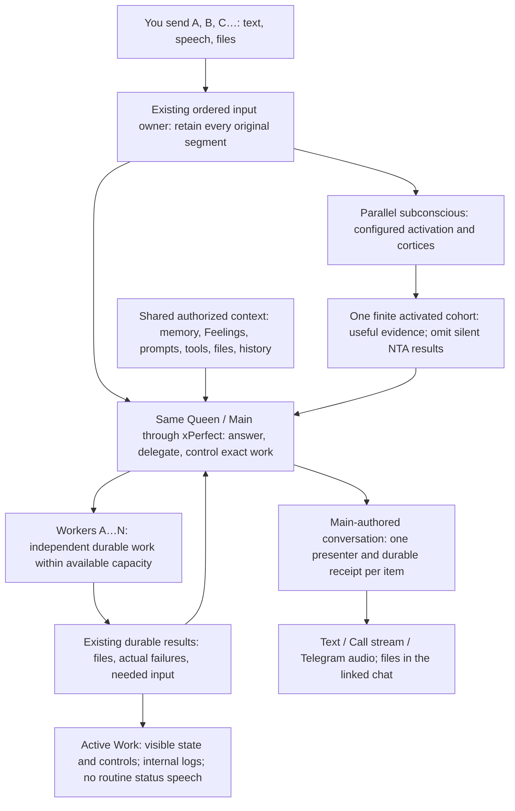
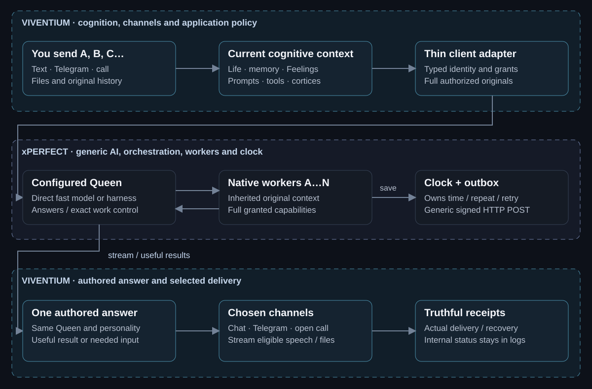
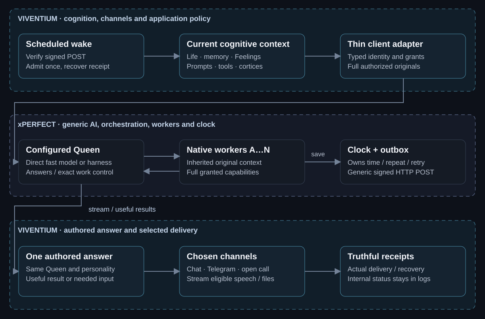

# Viventium cognitive-system vision

**Status: approved product vision. Accepted by the product owner on 2026-09-29.**

This is the source of truth for Viventium's high-level product definition, grouping, and cognitive
relationships. It takes precedence over earlier V0.5 vision and architecture proposals. The diagrams
below are part of this contract. Detailed feature owners define behavior and acceptance; the
[runtime overview](overview.md) and [QA catalog](../../qa/catalog.yaml) describe current implementation
and its evidence. Approval of this vision does not claim that every design target is shipped.

## One Soul. Everything connected.

The user faces one **Soul**: Viventium Core. Channels lead into the same identity and relationship.
The Core is powered by **xPerfect**, the intelligence unit and harness of harnesses. Its harnesses
include Codex, Claude Code, Grok, and future harnesses. The diagram places channels in one horizontal
row, then the Core, then its connected cognitive system, so the page reads in that order.

<picture>
  <source media="(prefers-color-scheme: dark)" srcset="assets/cognitive-system/viventium-0.5-dark.png">
  
</picture>

Open the full diagram: [light SVG](assets/cognitive-system/viventium-0.5-light.svg) ·
[dark SVG](assets/cognitive-system/viventium-0.5-dark.svg) ·
[light PNG](assets/cognitive-system/viventium-0.5-light.png) ·
[dark PNG](assets/cognitive-system/viventium-0.5-dark.png).
[Artwork sources](assets/cognitive-system/README.md).

## The grouping is the contract

| Layer | Role |
| --- | --- |
| **Channels** | Telegram, LiveKit calls, WhatsApp, web chat, and future surfaces reach the same Soul. |
| **Viventium Core / Soul** | One identity, one relationship, and one Main that owns user-facing judgment. |
| **xPerfect** | The Core's intelligence unit: a harness of harnesses with shared context and capable execution. |
| **Bio Lab** | Feelings, Subconscious, Continuity / Conscious Stream, and optional integrations that give the system life. |
| **Built-in wiring** | Life, Sleep / Dreaming, and Scheduling Cortex are part of the system's normal operation. |
| **Prompt Workbench** | Shared definitions for voice, tone, prompts, templates, how-to's, skills, keys, and variables; inspect, test, and apply them across waking and nightly work. A simpler future interface remains the goal. |
| **Cognitive system / SDK foundation** | Shared context and state, skills and tools, surfacing and continuity, with parity across paths. These are reusable building blocks, not isolated feature silos. |

### Bio Lab and the shared surfacing path

- **Feelings** includes Emotional State plus Baselines / Default Personality. It holds state that
  informs the Soul's behavior.
- **Emotional Reactions** belongs to the **Subconscious**. Reactions update Feelings. Background AI
  agents or workers also execute skills such as anti-sycophancy, reflection, and insight generation.
- **Continuity / Conscious Stream** is the Core's same Main staying aware over time. It decides
  whether to act, respond, or stay quiet; it is not a separate competing speaker.
- Background work, emotional state, Life context, nightly learning, and scheduled wakes use a
  **shared surfacing path** to reach the conscious Main. Their roles differ, but their building
  blocks and quality contract stay aligned.
- **Integrations / Other**, including the proposed Beautify note taker, extends this system.

### Built-in wiring and Workbench

**Life** supplies context. **Sleep / Dreaming** runs nightly reflection and memory hardening to
build a deeper connection over time. It connects with Subconscious work, Continuity, and Workbench
through shared context, learning, surfacing, and definitions. **Scheduling Cortex** provides wakes
and follow-through through the same path into Continuity.

**Prompt Workbench** spans the cognitive features and these routines. Voice, tone, prompt templates,
how-to's, skills, prompt keys / IDs, variables, and shared context must have visible definitions and
traceable live behavior. Provider credentials remain protected configuration; the diagram's prompt
keys and variables do not make credentials part of a prompt. Workbench supports defining, testing,
applying, and inspecting behavior and run history.

The arrows show conceptual relationships, not a claim that every module shares one runtime queue
or database. Solid connections carry context, work, or results. Dashed connections show shared
definitions. Across harnesses, channels, and background paths, parity means the same quality and
allowed capabilities, subject to each surface's real limits.

## Viventium cognition and xPerfect execution

**Viventium defines the mind and the relationship. xPerfect runs the AI and coordinates its work.**
Viventium owns identity, personality, Life context, memory, Feelings, cognitive prompts, and the
meaning and behavior of its subconscious and cortices. It also owns which channels the user chose,
what may be shown or spoken there, and the receipts that confirm delivery. These remain Viventium
capabilities when their hosting changes; removing LibreChat does not remove cognition.

xPerfect supplies the AI functions and runtime: direct model calls, native harnesses, configured
models and effort, reusable sessions, the Queen and Worker Bees A…N, handoff, steering, execution,
recovery, and the scheduling clock. Viventium supplies authorized context and capabilities through
that runtime. It does not recreate a harness manager, worker router, or second clock. xPerfect does
not decide what Viventium's Feelings mean, keep a second cognitive state, or require Viventium to
serve another application. Cognitive agents can execute through xPerfect without moving the
ownership of their definitions or state into xPerfect.

### Independent projects

**Viventium is a cognitive system and one of many applications that can use xPerfect. xPerfect is
the independent control plane, orchestrator, manager and harness of harnesses.** Neither its native
UI nor another application needs Viventium installed. This is a dependency direction, not only a
diagram label.

| Owner | Keeps and develops |
| --- | --- |
| xPerfect | Standalone UI/API/MCP, projects/goals/workers/runs, native coordination and configurable Queen, Direct/native execution, model/effort/accounts, authorized context/tools/files, sessions/warm capacity, workspaces, lifecycle controls, clock/outbox, artifacts, recovery and runtime evidence. |
| Viventium | Identity/personality, Life/memory/Feelings, Workbench/cognitive prompts, subconscious/cortices, continuity and sleep/dreaming, channel policy/media, conversation bindings and user-facing delivery receipts. |
| Viventium adapter | Translates Viventium identity, approved context, capabilities, files and channel bindings into generic xPerfect requests; receives generic results/due webhooks and calls ordinary Main. It owns application-specific configuration and migration. |
| Other applications | Their own domain state, context preparation, endpoint and presentation. They use the same xPerfect contracts or its standalone operator interface. |

New xPerfect code, schemas, configuration and defaults must not contain Viventium-specific routing,
cognitive interpretation, database/prompt dependencies or folder discovery. Put those behaviors in
Viventium's existing compiler/context/integration owners. xPerfect preserves authorized context,
roles, ordering, hashes and capabilities without deciding what a Feeling means. Its execution
history remains separate from Viventium's cognitive memory. Use one native management owner per
work item; do not run competing hosted-Main and standalone-coordinator ledgers for the same work.

Current source still contains host-specific environment, prompt/Feeling, authority/header and
broker compatibility. That is explicit transition work, not proof this separation is already
complete. Preserve exact context and authority while replacing the confirmed producers/consumers;
do not purge old fields or disable working clients to make the diagram look clean.

The xPerfect repository owns its generic technical plan and standalone success criteria in
`docs/09_Application_Boundary_Contract.md`, linked from its own architecture and README. Viventium's
[integration plan and success criteria](../requirements_and_learnings/capabilities/main-scheduling-continuity.md#viventium-integration-plan-and-success-criteria)
own only its adapter, cognition, channels and migration. The repository boundary is an approved
requirement. The runtime extension was approved on 2026-10-23; implementation and acceptance
are tracked in the owning scheduling contract.

### One relationship, with a fast Queen and capable workers

Text, Telegram, and Voice feed the same ordered input owner. Preserve every original A, B, C…
segment, files, history, authority, and unfinished work. The configured Queen is the Main: one
speaking personality that can answer, continue an existing worker, or start more workers. A fast
Direct Queen remains a valid configuration; cognition does not require an extra slow planning
model before each reply.

For the fast Direct profile, `hand_off_to` and `list_workers` are the small work interface. Action
capabilities belong to the configured native workers. Scheduling uses the scoped native-worker
tools described in the scheduling contract; existing Cortex definitions retain their service owner.
Handoff shares the original authorized conversation and context; it does not require the Queen to
rewrite a brief.
An accepted handoff confirms admission, not that the requested action succeeded. Worker results,
files, failures, and requests for needed input return to the same Queen, which talks naturally to
the user. Internal status belongs in Active Work and logs, not repeated chat or speech.

Subconscious activation and configured cortices run beside Main, without holding its first reply.
The finite activated set may pass one settled useful batch to the same Queen, excluding silent
“nothing to add” (NTA) results and without waiting for unrelated workers. Existing noninterrupting
native steering
is preferred where supported; otherwise use the existing durable Main follow-up. Keep memory
maintenance in parallel. This is the required behavior, not a claim that every native harness
supports live steering or that all cross-channel acceptance has passed.

### Scheduling keeps this same split

The approved scheduling integration uses xPerfect's existing clock to notify a configured
application endpoint. Viventium receives that signed due notice in its own adapter, restores its
current authorized cognitive context, and makes its ordinary xPerfect AI request. xPerfect runs
the configured Queen and workers; Viventium presents the result through the saved selected channels.
Another application can supply its own endpoint, context, and presentation without importing
Viventium. A standalone xPerfect worker schedule needs no application endpoint.

The [scheduling contract](../requirements_and_learnings/capabilities/main-scheduling-continuity.md#proposed-xperfect-scheduling-integration)
owns the trigger, authority, receipts, migration, implementation record and acceptance details.
The [Should-flow report](../../qa/parallel-orchestrator/reports/2026-10-23-should-flow-acceptance.md)
records the loaded local integration and bounded real-channel results. Retained Scheduling Cortex
definitions keep their existing owner until their migration is accepted; never run two clocks for
one occurrence. Approval and local acceptance do not certify every release or channel case.

## New-user journey

1. **Install** with a DMG or one command. Open-source distribution is the target.
2. **Connect an account / log in.**
3. **Connect channels.**
4. **Use it:** text, chat, or call the same Soul.
5. **Automatic upkeep:** updates, self-fix, and development that submits a PR within authorized
   boundaries.

The experience should remain simple and clear. Internal architecture must not make the user
coordinate the system.

## One continuous relationship · Text / Telegram / Voice

The same Main is the **Queen** across these channels. xPerfect owns harness execution and durable
**Workers A…N**, including their lifecycle and exact work controls. Viventium carries ordered
inputs, authorized cognitive context and results through the existing channel adapters. It must
not grow a second harness manager or require the user to coordinate the workers.

For A and B that need ongoing work followed by conversational C, Main can keep the work moving
and answer C. This is an outcome example, not a task classifier or a limit of two workers. New
input may revise only an unfinished Main reply; accepted work and every original source remain.
Useful late evidence enters that same Main through supported native interjection or a durable
follow-up. Results already delivered by Main may be silent later; do not force duplicate speech.
The finite subconscious cohort does not wait for unrelated long-running workers. Routine
maintenance and status updates are not spoken; Active Work shows current state and controls.
Main relays an actual useful result or specific needed question in the conversation.

The [Queen/worker and A/B/C contract](../requirements_and_learnings/55_Parallel_Work_Orchestration.md#locked-queen-bee-and-worker-bee-user-experience)
owns execution guardrails. [Interaction delivery](../requirements_and_learnings/capabilities/interaction-delivery.md)
owns ordering and presentation, [background cognition](../requirements_and_learnings/02_Background_Agents.md)
owns the activated cohort, and [Voice](../requirements_and_learnings/capabilities/voice.md) owns
speech and call authority. These are existing owners, not new routing layers. Standalone xPerfect
does not acquire Viventium's memory, Feelings or speech authority merely from a connection.

This diagram defines the contract. The [dated acceptance report](../../qa/voice/reports/2026-10-17-native-continuation-and-memory-recovery.md)
records the tested paths and open gaps; it does not certify every provider or a latency target.

## Target and current delivery

The diagrams define the direction. WhatsApp is **planned**; Beautify is **proposed**. The DMG,
open-source distribution, and automatic upkeep are design targets, not release claims. Current
licensing is **source-available**, as specified in [LICENSE](../../LICENSE). Current install and
release support belongs to [runtime, install, and release](../requirements_and_learnings/capabilities/runtime-install-release.md).

For changes, use this vision with the [key principles](../requirements_and_learnings/01_Key_Principles.md)
and the [owning feature contract](../README.md#capabilities-and-acceptance). Earlier V0.5 proposals remain
useful exploration; they cannot override this approved definition or approve unrelated UI,
licensing, implementation, or release decisions.

## Approved application boundary diagrams — 2026-10-23

### Ordinary conversation

### Scheduled continuation

Horizontal dashed boundaries separate application cognition from generic execution and orchestration.
These are the approved ownership and flow diagrams. The scheduling capability contract owns current
implementation, configuration, acceptance and retained compatibility; a diagram is not a test result.
