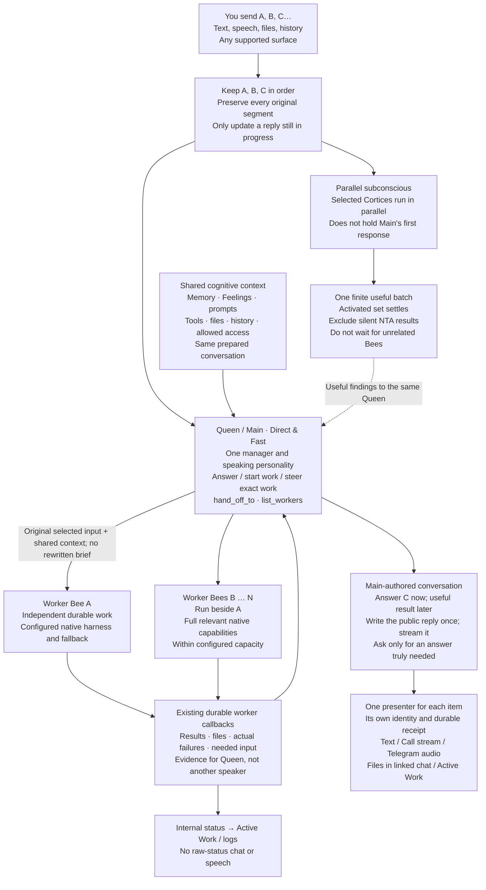

# Voice

## User promise

Voice Call is a real-time surface for the same authorized Main. Speech stays responsive, interruption
does not lose durable work, and an accepted effect happens at most once. Listen-Only records ambient
transcript evidence without acting as an assistant.

## Authority and interruption

### Interruption

- **CC-019:** Interruption stops or revises presentation only. It never cancels an accepted schedule,
  mission, or external effect.
- **PW-051:** Spoken interruption revises unfinished speech once. Hangup or network loss does not
  cancel accepted durable work.
- The authenticated Call owner may Stop an exact read-only reply generation. Native Stop is confirmed
  only after that request family has released capacity. This does not grant an unverified speaker
  tools, work controls or native input, and does not cancel an accepted mission or external effect.
- A state-changing voice command reserves its durable owner-and-turn identity before provider
  execution, persists the terminal outcome, and reconciles retries against that same record.

Speech cancellation preserves the original input admission and its authentic Core receipt in the
existing call continuation lifecycle. Consecutive inputs keep their original text and source
identity; admission ordering remains separate from speech presentation. Waiting for the predecessor
receipt does not consume the successor's own transport deadline. An authentic ready receipt binds
before a separate removal acknowledgement can fail. That acknowledgement uses the existing bounded
call-owned task; it does not block later inputs after a genuine receipt. End drains the owned
admission, HTTP and acknowledgement tasks. Missing or failed receipts never create a removal
acknowledgement or new action authority. Retention before Core admission is limited to the live call
process; a transport timeout does not prove admission.

The same source recovery accepts an unfinished Web predecessor for a Voice successor.
The successor's declared additive scope owns input continuity. Recovery still requires
exact source and owner identity, actual removal evidence, released execution and fresh
accepted-work facts within the existing deadline. Partial removal does not prove provider
completion or grant new authority; unanswered inputs retain their content and order.

### Terminal media loss

A native terminal room disconnect reports failure through the exact current gateway owner.
After that report is accepted, job shutdown stops local authenticated couriers before releasing
only that worker's lease. The existing Retry path can then reclaim the call without waiting for
lease expiry. Transient reconnects and intentional local disconnects do not release ownership.
Durable conversation work continues and generated speech alone never proves playback.

### Barge-in

- **CC-049:** Stable barge-in suppresses stale speech. A false interruption may resume; a stable one
  never does.

## Worker interaction

LiveKit sends speech through the existing voice gateway and LibreChat agent route to the selected
Voice Call LLM, or the Main LLM when no override is set. The Main source default uses
xPerfect → Grok 4.7 at high effort for Voice, with xPerfect → Opus 5.5/high as its configured fallback.
xPerfect serves as the text brain in this cascaded pipeline, with the same authorized harness
actions and model/effort selection as other
surfaces. Native realtime audio remains a separate capability; speech recognition and speech output
remain separate from the LLM. Provider defaults are GPT-6.1 Sol, Opus 5.5, and Grok 4.7 at high effort.
Other supported models and efforts remain selectable. Grok 4.7 Fast uses the Grok Build harness,
not the public xAI API. Owner-authorized call task controls use the same tool implementation through
the signed native capability broker. They recheck the accepted turn authority before each call and
are not inherited by delegated missions. Native Grok permission requests use the existing Call
activity input controls and the exact authenticated provider request mailbox. The Call UI shows
the complete bounded action description and the native offered choices. Submission rechecks the
call authority, owner, run, attempt, request fingerprint and expiry. Authenticated full-access Grok
conversation runs request native always-approve mode; other conversation access requests native ask mode.
Native deny rules, hooks and managed-policy restrictions remain enforced. Requests that still need
a native response use these same Call controls. Simultaneous native requests are shown one at a time. Denial, cancellation and expiry
keep their typed native outcome through chat and speech, and cannot start a provider fallback.
Call activity renders the authoritative task error message. Terminal tasks with an error remain
visible until the user dismisses them; terminal tasks without an error keep the brief existing
display. Dismissal changes only the displayed card, not the task outcome or action authority.
Recovered native error results settle the Call task as failed rather than completed.
Typed completion errors also settle non-native Call tasks as failed, including context failures.
An empty interactive assistant answer is a typed `provider_response_failed` outcome, so the existing
configured fallback can recover before speech starts. If recovery returns no answer, the task fails
and speech reports that result. Empty graph transfers, declared silence and background turns keep
their existing contracts; raw native output remains available for private audit.
An unanswered failed tool receipt remains in the audit history and raw ancestry; it is not carried
as an accepted Main answer. Visible answers and file-bearing rows retain their existing guards.
If Fast is absent from the native catalog and Grok 4.7 is present, the request uses and reports Grok 4.7.
Server-local MCP names do not contain the qualified-name separator. The same approved tools remain
callable in Grok, Codex and Claude. Prior broker names remain accepted lookup aliases with the same
grants and approval gates.
OpenCode integration is deferred in the backlog.

The [2026-10-03 local QA report](../../../qa/modern-playground-voice/reports/2026-10-03-voice-and-telegram-acceptance.md)
records current model defaults, Telegram photo/document delivery, voice selector save/reload,
spoken recall, early streamed speech and once-only worker completion through captured audio and
durable sent settlement. The linked prior report retains unchanged verified-owner tools,
approvals, recovery, Feelings, cortices, memory and interruption evidence. Full-flow latency joins
actual input PCM end to browser audio and distinguishes provider activity from model tokens.
Physical response under two seconds is not met. Normal Call has the account-bound microphone-track
authority described in [Voice Calls](../06_Voice_Calls.md); it does not identify the human speaker.
Wing and Listen-Only retain their separate verified-speaker requirements. Full hardware microphone
acceptance, the rejected hosted Listening route and genuinely off-network
public-file acceptance remain open. Original linked-owner Web sign-in was recovered through the
normal login path; that recovery does not establish microphone action authority or resolve the
hosted Listening rejection. Short non-lexical sounds can produce false local-ASR text;
unqualified filenames retain the native bare-link behavior. These bounded results do not establish
universal recognition accuracy, glitch-free audio, full microphone parity or release readiness.

### Plain action acceptance

Voice action readiness requires a plain user goal to produce the requested effect through the
selected native harness or an accepted durable worker. The user need not name a tool, provider,
worker or delegation procedure. In a configured Queen/worker split, action success requires
a durable worker acceptance; direct harness execution counts only for a single-executor setup.
Test an ordinary browser action and another authorized local
operation, plus a conversational input that needs no action. Join the original input to the exact
native attempt, real tool result, visible effect and final spoken claim. A reply such as “opening
it now,” a successful provider completion, or an active-work card does not prove the effect.

Successful explicit worker-launch tests do not establish plain-action readiness. Record results
for each configured Voice route separately; a working Codex Chat route does not establish Grok
Voice parity. Preserve a failing attempt when retrying and report its actual outcome. Configuration
changes must remain explicit; do not conceal a provider substitution or add intent matching,
promise detection, forced delegation, or another routing layer to make a case pass.

### Queen execution and worker execution are separate settings

In the Queen/worker configuration, the Voice Queen owns the conversation and exact work
coordination. The configured workers execute action requests, including small actions. A plain
action request must reach the durable delegation tool without the user naming a provider or handoff.
The worker profile, model, effort and fallback remain independent of the Queen execution mode.
A Direct Queen still runs inside xPerfect and uses its existing authorized broker, context,
worker receipts and callbacks; it is not a separate host-side manager.

Treat native tool discovery, Direct function binding and actual worker acceptance as separate
claims. A model can produce a valid final response without calling any tool. Tool readiness and
explicit-delegation probes alone do not prove plain-action behavior. Selecting an existing Direct
route can be a configuration remedy when its real path passes, but does not prove the native route
repaired. Keep supported alternatives and disclose the selected mode. Preparation remains optional;
it is neither a prerequisite for delegation nor a proven speed optimization.

Direct uses the selected provider API connection and its API billing. A native subscription does
not pay for Direct requests. Where the executor cannot accept live interjection, useful background
context uses the existing durable Main follow-up; this is not proof of mid-reply incorporation.
The accepted Direct configuration delegated small actions with the existing prompt unchanged.
A proposed prompt change still requires the existing old/new Prompt Workbench comparison; do not
treat this configuration result as acceptance of the rejected wording candidate.
Measure end-of-input to first received audio separately from worker acceptance and final results.
A successful Direct handoff does not establish a latency improvement. Do not lower effort or omit
cognition to label a route fast.

### Fast Direct Queen with prepared context and live work awareness

#### Should / fixes · Direct Queen

This is the approved flow, shared by Text, Telegram and Voice. It defines expected behavior;
dated [candidate results](../../../qa/voice/reports/2026-10-21-prepared-direct-queen.md) define what
has actually passed. The Queen and Worker Bee names describe existing roles, not extra services.

Viventium carries the original input, cognitive context and presentation. **xPerfect owns Queen
and worker execution, handoff, work controls and callbacks.** Do not add another routing agent,
intent classifier, action-specific pipe or channel-specific manager.

The saved Main is the shared foreground owner. Chat, Telegram, Main-authored callbacks, scheduled
Main work including Consciousness Continuity, and Main continuity compaction/review follow that
saved route. Selecting Direct Grok Low for Main therefore changes all of those consumers; it is
not a Voice-only switch. The saved-memory writer and Feelings reaction retain their explicit High
routes, and native action workers retain their separate models and fallback. Do not claim
continuity parity from a fast chat reply: run the owning synthetic compaction-fidelity check on
the selected Main route. This uses the same existing compactor, not another compaction agent role.

- **A, B, C:** independent A and B may run beside each other while Queen answers C. A correction
  to A uses A's existing work identity; it must not start A again or affect B. New input may
  revise only an unfinished reply, never cancel accepted background work implicitly.
- **Full context without broken telephone:** the handoff selects the original input and exact
  work target. Existing authorized snapshots and readers supply conversation, prepared awareness,
  memory, Feelings, files/history and relevant tools. Queen must not generate a substitute brief.
  Historical context is evidence, not permission to repeat old actions; unrelated private data
  and credentials never cross the boundary.
- **Fast acknowledgement, independent execution:** acknowledge only after the durable acceptance
  receipt, without waiting for completion. Reuse a valid authored reply after acceptance where
  the output contract supports it; generate another only when needed. Do not speak speculative
  promises, arbitrary provider prose or internal tool/status text to shorten a timer.
- **One voice:** useful worker results and needed questions return through Queen. Raw memory
  maintenance, saved-memory notices and generic worker status belong in logs / Active Work,
  never in conversation or TTS. Useful subconscious findings form one finite activated batch;
  `{NTA}` findings stay silent. Use native live injection where supported, otherwise the existing
  durable Main follow-up. A follow-up is not proof of mid-reply consumption.
- **Same ability across surfaces:** each supported Text, Telegram and Voice path retains the
  authorized outcome, context, tools, files, work controls and once-only delivery. Presentation
  can differ. A successful Web action does not by itself prove Telegram or Voice acceptance.
- **No capability cuts for speed:** memory maintenance and background work remain parallel.
  Preserve intelligence, Feelings, cortices, prompts, history and permissions. Use the existing
  process warm pool and context/session reuse; do not rebuild them or call a retained workspace
  a warm model.

Optional call preparation is a separate startup stage: **Main updates existing Life awareness in
the same conversation → its report stays visible and silent → the configured Voice Queen
continues in that conversation.** Reuse prior context and gather changes; do not rebuild it per
turn. When preparation is off, Queen uses available context and ordinary memory. When enabled,
do not silently replace this order with parallel preparation. Its timeout and exact cancellation
must preserve input and permit the existing truthful degraded recovery. This is not a new
preparation framework or an authorization bypass.

An optional operator-owned `voice.prebuild_context.execution` provider/model/effort tuple can
keep preparation on a capable native Main while the speaking Queen uses Direct. Omitting it
preserves the saved Main route. The compiler and current provider capability registry must accept
the exact tuple. Only a current call's owner, agent, conversation, preparation receipt and deadline
can select that server policy; an HTTP model tuple cannot override normal scheduled work. Native
fallback remains the agent's existing `glasshive_options.fallback_model` and effort, with the
same xPerfect validation and recovery. Do not create another fallback manager or change workers.
The daily fast configuration can leave optional preparation Off while keeping its native High pin
ready for later enablement. Off retains normal Life, memory, Feelings, prompts, history, current
work awareness and tool access. It avoids the optional startup wait; it does not repair a failed
prebuild or prove the sub-two-second speech objective.

The intended deployment keeps native workers on Codex GPT 6.1 Sol / High with configured
Claude Opus 5.5 / High fallback. Worker models and fallback remain configurable independently of
the conversational Queen. A … N means capacity-bounded parallel work, not a two-worker limit or
unlimited provider capacity. OpenCode remains unchanged and backlogged.

The target configuration is one Direct conversational Queen inside xPerfect, backed by the
configured native workers A through N. Viventium carries input, authorized cognitive context and
presentation; xPerfect owns work. This is a configuration of existing mechanisms, not another
orchestrator or a task-specific routing table.

The canonical Voice default uses xPerfect Direct xAI / Grok 4.7 / Low, with coordination mode.
Low is the lowest supported effort, not disabled thinking. Main and native worker effort remain
independent; saved explicit alternatives are preserved.

- The Fast Direct Queen uses the existing orchestration option `tool_mode: coordination`.
  Its action interface is `hand_off_to` and `list_workers`. The handoff starts configured work or
  applies the existing exact-work controls; it does not wait for the worker's result. Schedules,
  web and file search, diagnostics and other action capabilities remain on workers. Do not remove
  those capabilities globally, add action-category routing, or restore the whole action catalog
  to the Queen as a substitute for a working handoff. The explicit `full` option retains the wider
  interface; native workers and their configured fallbacks keep their existing capability grants.
  A natural acknowledgement must follow an accepted receipt and must not claim completion.

- When enabled, the existing preparation prompt uses Main and its fallback once at call start to
  gather situational awareness incrementally from Life, memory and current work in the same
  conversation. Keep its report visible and silent. Measure preparation separately from later
  conversational turns; do not repeat the whole preparation for each input.
- Each Queen turn receives the prepared context plus the latest authorized work state and results.
  A preparation snapshot alone is not a fresh work roster. The Queen decides whether to answer,
  start independent work, or Message/Steer an exact existing worker. Do not create a duplicate
  merely because another message arrived. No keyword router or extra classification model is needed.
- Worker handoff preserves the full authorized conversation/context and tool access through the
  existing context owner. Distinguish included prompt content from source references that require
  retrieval. Do not call a limited inline preview a full copied prompt, and do not make the Queen
  write a fresh recap to reconstruct context for each worker. The handoff selects a worker and,
  when needed, a short task focus; the existing context owner supplies the exact authorized source
  conversation. A model-authored `instruction` must not be a required substitute for inheritance.
  Share context through existing snapshots/readers or native conversation binding, preserving
  roles and provenance. Do not copy credentials, raw tool configuration or hidden authority from
  a provider journal, and do not fabricate another owner’s conversation records.
- Existing background enablement controls whether asynchronous work is allowed. It is not a
  promise of instant inference. Worker models, efforts and fallbacks remain independently
  configurable; A through N are examples subject to actual capacity and authorization.
- Stream eligible conversational words into the existing TTS path as they arrive. Internal
  maintenance and status remain silent. A worker result must not hold an unrelated conversational
  answer; only necessary action acceptance or an actual answer dependency can gate that answer.
- Compare the exact provider request, model, effort, context, tools and output contract before
  blaming a cold process or transport. Separate time to first raw model text, time to accepted
  work, time to eligible spoken text and time to received active audio. A plain one-tool microprobe
  without the cognitive context is diagnostic, not parity acceptance. Report sample count and
  arithmetic mean per stage; do not fabricate stage averages from one successful run.

Provider effort names are not interchangeable. Grok 4.7 cannot disable reasoning; `low` still
reasons and `none` is rejected. GPT 6.1 Sol and Opus 5.5 also do not offer disabled reasoning.
Never label Low as Off or silently substitute a different model. A request to turn thinking off
requires a supported explicit model choice. Keep worker effort independent from Queen effort.

Prepared-context latency has two separate measurements: building the report once, and processing
the already prepared input on each model request. Record the input size by owned layer and the
provider's input, cache and reasoning usage. A two-tool diagnostic can still be slow with a large
history and conflicting output instructions. Cached input does not guarantee immediate speech.
Remove a repeated context body only when stable source identity and exact admitted content prove
that the retained representation covers it; preserve other-thread sources and durable originals.

The latency objective remains useful speech within two seconds after user speech ends. Direct
execution, preparation, warm executors and provider caching are separate levers, not proof that
this objective is met. Parameter experiments must remain explicit and preserve action quality,
context, memory, Feelings and worker capability. The exact observed configuration and incomplete
acceptance gates belong in the corresponding dated QA report.

Historical retrieval evidence must survive the shared history formatter when it is the only
content of a settled assistant row. Carry exact bound source data with an explicit untrusted-data
notice in both provider history and its integrity digest. It is neither an assistant answer nor
proof that preparation completed, and grants no current file access. Keep normal context budgets
and ownership checks. A completed report retains its existing authored representation; do not
append raw retrieval to every successful report as a new latency cost. This rule repairs blank
retrieval-bearing history, not a new context-building pipeline.

### Worker controls

- **PW-050:** In a normal Voice Call, Main remains available and may perform explicit authorized
  launch, list, queue, message, Steer, Pause, Resume, Stop, Retry, or Dismiss actions on exact work.

Reconnect keeps the audio choice for each validated public model envelope on the existing text
part. Main can speak an update and keep a later result silent, or do the reverse, including when a
native tool joins those envelopes at one graph content index. Adjacent identical choices share one
range. Resume deduplication counts silent text as received text. Core's visible aggregate owns local
resume; Redis reconstructs only emitted public chunks when that aggregate is unavailable. Hidden
specialist evidence does not become public speech on reconnect. Absent range metadata keeps the
existing audio default; present malformed range metadata stays silent. The unannotated terminal
`audio=skip` fallback remains silent. These controls
change presentation only; they grant no tool or effect authority.

- The selected cloud speech-to-text route may receive a bounded typed list of display names from
  owner-visible artifacts in the current conversation, including native artifact filenames retained
  in owner-bound message metadata. It excludes file bodies, paths, digests, secrets, and other-owner
  data, and it must not change the selected provider or route.

### Result presentation

- **PW-052:** Main speaks concise verified status or completion once. Files remain available in the
  linked chat or Active Work. Viventium never starts an unsolicited result call.

Canonical Call transcript and linked-chat text retain complete public links and authored email
addresses, including file and workspace actions. Requested details supported by the conversation
or verified results belong in that same written reply; Main does not ask again whether to send them.
Speech keeps the existing short reference cues, without duplicating an offer or availability
announcement. This presentation contract does not invent an address, reveal explicitly withheld
information, or change silent/text-only delivery. The display path preserves exact reference bytes;
only the speech path applies spoken boundary repairs. An incomplete inline link stays as literal transcript text until it is complete;
its partial target is not clickable. Speech uses its existing artifact cleanup and selected renderer's streaming
policy. Main uses the SDK's separate text and audio paths; its speech buffer applies only to TTS.
Background completion display retains the full authored text while speech keeps the existing
follow-up cleanup and length cap. Voice controls stay hidden from display. Owner, mode, presentation,
speech-permit and playback checks remain in force, and link visibility does not change file access
or Call participant grants.

The Call offers **Open in chat** during and after the call, including an ended-page reload, using its current or canonical result
conversation and the existing verified opener origin. It opens the normal authenticated chat,
where persisted file cards remain usable. Main's authored link targets stay unchanged.
With current call access, a completed public reply can show filenames from its owned saved File
rows. The file card has **Open in chat** and **Dismiss** and survives the transient activity hide,
within the existing task-history limit. The task read exposes only filenames as file metadata.
Completed generation, native-worker and callback-delivery tasks use their private task-owner
identity for this read, including tasks without a generation logical turn. This read does not
grant speaker or effect authority.
Missing, deleted, unavailable or out-of-scope results create no file card. Ended calls and reloads
use the existing authenticated chat handoff without extending the call capability.
When playback acknowledgement commits a previously unfinished reply, the existing task feed sends
a new snapshot. The file card reads once per task revision. Duplicate acknowledgements keep one
completion and one spoken result. A file-card refresh failure does not block Main turn acceptance.
Denied browser session storage follows the existing call recovery path without blanking the page
or adding an authorization fallback. The launch fragment is removed before storage is attempted;
call teardown still runs when browser storage cannot be cleared. Call activity
maps the declared internal task phases to the existing task-state label and omits phase text that exactly
repeats the heading or state badge;
meaningful progress text, counts, sources, errors and task controls remain visible.

### Speaker authority

- **PW-053:** Only an explicitly engaged trusted Wing may use its authorized speaker role. Passive,
  unverified, and Listen-Only participants cannot launch or control work.

The signed browser engagement proxy keeps its 8.5-second upstream deadline and browser cancellation
active through the complete response-body read and response construction. Receiving headers does
not end either guard; a stalled body retains the existing timeout or unavailable classification.

## Call entry from Telegram

- Telegram `/call` mints one browser-facing link through the same call-session service as the web
  call button. The link uses the configured public playground origin and carries a single-use
  launch bearer only in its fragment; a replayed or expired link is denied honestly.
- The link bootstraps only where the public HTTPS edge is reachable. A device on the serving Wi-Fi
  reaches the public hostname only when the router provides NAT loopback or an equivalent split-DNS
  or mesh route; that precondition is owned by
  [remote access](../47_Remote_Access_and_Tunneling.md), not by call code, and a same-network
  timeout with off-network success is never an application regression.
- Remote-access status may claim only what this Mac observed: reachable from this network, local
  hairpin unavailable, or not probed. Off-network reachability is proven by a real off-network
  client, never inferred.
- Durable journey: `qa/voice/cases.yaml` `telegram-call-public-edge`. Telegram QA links to it and
  does not duplicate it.

## Listen-Only

- **VOICE-001:** Listen-Only records visible ambient transcripts through the configured speech-to-
  text route, including a supported local zero-model-token path.
- It produces no assistant or TTS response, title, tool call, background mission, live memory write,
  or normal conversation-recall entry.
- Mode changes are atomic. Uncertain speaker identity stays `Unknown`. Later memory processing may
  use the transcript only as soft, corroborated evidence.

## Failure, recovery, and privacy

- Distinguish missing authorization, unavailable media service, provider rejection, timeout,
  interruption, and completed playback.
- Completed playback—not audio generation or track publication—is the user delivery boundary.
- Worker completion requires a done, non-interrupted speech handle and positive native playout
  evidence for that exact handle. The existing assistant audio metrics or the enabled audio
  output's native `playback_started` first-frame event supply this evidence, including consecutive
  speech when the global speaking state stays unchanged. A queued worker cannot borrow another
  speaker's event. Interrupted, unheard or uncertain output retains `delivery_unknown` under the same claim
  and dispatch permit; it never settles a coalesced worker presentation or enables blind replay.
- If a canonical response has a typed unavailable file attachment, the current speech stream adds
  “The file could not be attached.” once. Main's authored reply, result identity and cortex context
  stay intact, including when linked background work still runs. Generation errors take precedence.
  Text-only delivery, declared silence, Listen-Only, Stop and supersession keep their speech fences.
- Raw audio retention stays zero unless a separate explicit product policy says otherwise.
- Transcript and task data remain owner- and call-scoped and follow normal retention and deletion.

Concurrent Phase B authors can share an occupied native conversation session. For a declared
durable session with activity and idempotency support, the existing native admission adapter
retries only the typed `conversation_session_authority_conflict` response using the identical
signed request. It keeps the transport cancellation signal and the existing 30-second admission
budget. Other authority conflicts remain failures. Budget expiry returns the original typed
failure. The producer settles every exact admitted row with the enum-backed
`native_session_occupied` failure event in the existing durable insight ledger. Recovery reads
that owner-scoped append-only evidence, independently of later parent decision metadata.
Recovery uses the owned parent, original
Call/task/stream/source revision and pinned Feeling snapshot; explicit Stop still suppresses it.
It re-authors the stored insight under current conversation context with the same parent/agent
idempotency key and a fresh signed read-only Native capability. It does not retain or replay the
old serialized request or reconstruct microphone action permission.

A live recovered follow-up saves one canonical message and wakes the existing task feed. Saving
text never confirms speech: the authenticated Voice receiver still prepares and confirms its
exact presentation. A saved live child retries the existing exact task wake and parent backoff;
it is not re-authored or reclaimed by the recovery scan. The existing child event identity
deduplicates wakes, and the durable task tail retains missed publication for receiver replay.
An unended Call with a temporary gateway lease gap stays pending through the existing backoff;
only that original Call may reclaim speech. An already saved result stays saved during the gap.
Model-declared silence remains valid. If the original Call ends or expires, recovery preserves
useful linked-chat text and truthfully closes the unavailable Voice obligation after persistence;
it never switches to another Call, changes required surfaces, or reports text as spoken. Missing
or conflicting retained task/source authority fails closed; permanent scope conflicts use the
existing claimed-attempt limit and terminal outcome. Transient store failures retain backoff.
The existing one-complete-batch-per-parent guards remain unchanged. Inconsistent legacy row
causes remain pending without slicing the batch, authoring unrelated insights, or dropping a
retained typed contribution; multiple declared parent cohorts remain rejected at admission.
Older rows without the typed event are not reclassified from mutable parent metadata.

A pending Main-authored worker completion publishes its exact hashed callback reference through
the existing durable call-task feed after the result transaction commits. Reconciliation and
task replay recover a missed wake. This publication is discovery only: the gateway still claims
the matching owner and current-call delivery, checks its accepted result and speech permit, and
speaks Main's validated text through the existing renderer. A later foreground turn does not
erase that independent delivery. Listen-Only, Stop, ended calls and completed presentations keep
their existing speech fences. Neutral worker callbacks do not acquire speech authority.
When an older worker observer reaches an already-sent result, the existing claim response
can return its exact owner/current-Call settled receipt after checking the accepted callback
operation. The observer stops once its known terminal callbacks are settled. Empty claims,
pending or unconfirmed delivery, foreign scope and superseded results keep the existing retry
and deadline behavior; the settled receipt cannot authorize or repeat speech.

Acceptance follows the requested outcome, not one announcement per worker. A successful Main-authored
`{NTA}` decision is terminal when no new user-facing result is needed. Check the accepted callback
identity and the actual delivered outcome; require completed audio presentation for every visible
Voice follow-up, but never force another announcement of a result Main already delivered.

## Orchestration observability

Voice retains the Main prompt, connected capabilities, Feelings snapshot, activation decisions,
independent cortex execution and Phase B presentation. Traces join these stages to the trusted call
and logical turn with domain-separated hashes. Activation detection uses a fresh invocation identity
and records each cortex once within that invocation. Model receipts distinguish the requested model
from the actual native catalog selection, and retain the configured effort.

Phase B uses the same declared Native output contract as Main. An owned active Call or an
authenticated audio adapter supplies audio eligibility; a caller's surface or Call label alone
cannot. Native validates the typed `assistant_response` and exposes only its authored content.
Text and file JSON outside that declared contract remain literal data. Phase B retains the model's
versioned audio disposition on both new and promoted saved replies. `voice=skip` suppresses only
Voice presentation, including its legacy insight fallback, while linked text and files remain
available. An exact accepted suppressed worker delivery settles its observer without authoring,
speech, dispatch or replay; pending siblings keep their existing retry behavior.

Native Grok receives the existing typed conversation output schema through ACP
`session/prompt._meta.outputSchema`, including resumed turns. The private schema file is checked
against the request contract before launch. The shared native schema makes `assistant_response`
the final result for the turn: complete authorized work now or report its actual blocker. A real
accepted asynchronous work receipt can still be acknowledged before that work completes. Graph
transfers continue through the existing typed `tool_call` result. This is transport truth, not an
extra Main instruction or a terminal retry loop. Conversation instructions do not acquire a worker's
`FINAL REPORT` completion contract. Provider authority receipts check the materialized instructions
and reject duplicate Feeling capsules. Grok conversation sessions use the exact pinned authority
in native `systemPromptOverride` on creation and resume; creation-only `rules` remain for mission
workers. A model change during native setup reapplies that authority before prompting, and effort
updates recheck the exact native model. A configured model change rebinds the conversation to a new
native session and seeds its visible history through the existing provider mechanism.
Native Grok observations include receive time in UTC, monotonic elapsed milliseconds and runner,
process, session-open and prompt-start markers. These distinguish observed setup and prompt time;
they do not infer hidden reasoning, provider queue time, cache behavior or unavailable token usage.
Enabled latency logging also separates request-local bundle copying from restart-authority
reconciliation. Existing xPerfect admission observations separate handler entry, authorization,
thread dispatch, session-lock wait, model selection, session/context preparation and the request
write. Handler entry follows HTTP middleware and body validation. A stored row creation timestamp
is assigned before its transaction and does not prove write completion or pure transport time. Each Native interval records a fixed completed or failed status. Core records the
awaited initial message persistence sequence, the cumulative message-build prefix through
continuity, and the local formatting, token-accounting and RAG interval before memory recall.
The continuity prefix includes earlier preparation; the formatting interval is not pure
tokenization. Nested and cumulative intervals overlap and must not be added together. Core build
markers report only reached boundaries; they do not claim that memory is available or that a failed
build completed. Disabled logging leaves the existing execution unchanged. These records contain
fixed stage names, numeric times and hashed request identities, without source text or memory keys.
STT segment times retain their relative call-audio clock. The worker maps their end offset to UTC
through the call's paired monotonic/UTC origin before joining dispatch and provider stages. The
trace identifies this as the STT call-audio timeline; final-transcript observation remains a separate
timestamp. A missing origin remains unavailable. Neither timestamp substitutes for measured
physical microphone end in delivered-audio latency QA.
With latency logging enabled, the pinned provider wrappers separately record receipt of
AssemblyAI's end-of-turn event, observation of its final transcript, and SDK turn-commit entry
and exit. Word-end offsets remain provider-relative. The configured xAI instance records first
accepted text, websocket connect, first text write and first audio receipt. Socket reuse is
observed at every actual lease; it is not assumed for a later turn. The pinned xAI adapter returns
only completed clean sockets to the SDK pool, evicts interrupted or failed leases, and warms the
selected primary during Main inference. Settings changes retire old idle sockets while active
speech can finish. Call close owns pool cleanup. Unsupported SDK versions keep
their original behavior and report that the measurement is unavailable. These records contain
hashes and typed timing fields, not transcripts, credentials, provider URLs or audio contents.
The first decoded PCM record observes nonempty raw PCM passed to the SDK emitter after
base64 decoding. Websocket audio receipt occurs before that boundary. Neither record proves
remote receipt or audible playback. Main and the independent cortex presenter own authored
speech. Runtime task events remain typed status for task cards and the durable relay; they do
not create canned verbal acknowledgements or progress narration. A completed speech handle
alone is not evidence of audio delivery. Real Voice acceptance still requires received PCM or
captured audible output.
If a reused socket accepts text but returns no first PCM, the existing request timeout starts
at that text write. Model inference is excluded. Native retry can recover before audio;
after first PCM, the original renderer owns the complete tail without replay.
For an actual native streaming Speaking renderer, the gateway releases complete safe word
prefixes when the next lexical token begins. It retains the last word for delayed punctuation,
numbers and unfinished markup. The renderer keeps one continuous text segment until input ends;
the gateway does not flush once per word. Unknown and non-native renderers keep the existing
phrase policy. This boundary does not guarantee audio from a single unfinished word, eliminate
provider synthesis time, or establish glitch-free playback. Acceptance requires the loaded
first emitted chunk, provider input and delivered audio boundaries on the same actual turn.
Each new fallback stream resets this input policy to its actual primary renderer, and each
attempt updates it before input replay. Audible provider, controls and route metadata still
change only after that attempt produces audio.
Optional native observations distinguish catalog hits, joins, TTL refresh and scope-or-cold
misses through hashed scope components. They also report session binding decisions, executor
submit/entry and existing start-lock wait and hold boundaries. These observations do not change
catalog validation, native execution authority, scheduling, locks or socket lifetime. A scope
miss requires comparison with retained observations; a cache counter alone is not proof of its
cause. End-to-end latency still requires the actual loaded path and browser audio measurements.
Native Claude turns disable system-prompt snapshots when
that installed CLI supports the flag, so a resumed turn can receive its current pinned state.

Playback acknowledgement records the accepted delivery state, revision and hashed call/turn.
The generation store retains the server-bound Voice call, task and effect identity across Redis
serialization. Late TTS metrics join the same actual speech handle; completed playback may precede
the metric callback. Trace finalization waits while that handle is active. Native input lookup uses
the authenticated request family, including graph children, without relaxing owner or tenant checks.
Intentional silence or superseded speech is distinct from failed playback. Phase B keeps committed
native evidence strict, waits within the existing delivery grace period for an external adapter,
and reports unavailable parent evidence without blocking ordinary cortex insight presentation.

When a local source runtime lacks release-bound durable trace identity, a bounded redacted event is
written to the local log with that limitation stated. It must not manufacture release identity or
count these records as installed-release acceptance. Raw prompts, transcripts, model outputs,
credentials, owner IDs and call IDs are excluded from this trace transport.
Authenticated late audio events use the retained task binding after the generation job expires;
a conflicting live job is refused. A local diagnostic acknowledgement explicitly reports
`durable: false`. Completion failures log only their class, status, code and diagnostic hash.

## Owners and QA

- Real-time media: `viventium_v0_4/voice-gateway/`
- Durable call/task authority: `viventium_v0_4/LibreChat/api/server/services/viventium/`
- Browser surface: `viventium_v0_4/agent-starter-react/`
- QA: `qa/modern-playground-voice/`, `qa/voice-call-hardening/`,
  `qa/voice-streaming-first/`, `qa/voice-turn-taking/`, and `qa/listen-only-mode/`

Acceptance requires the installed call path, an audible result, interruption and recovery,
persistence, durable-effect exactly-once proof, and source/build/installed identity. Logs or a
published audio track alone do not pass.
For an explicitly authorized local engineering audio case, real browser microphone injection through
LiveKit and captured returned speech can supply delivered-audio evidence. Check waveform content,
interruption timing, accepted revisions and task state, rather than just media-element state or
nonzero energy. Keep aggregate failures visible. This does not claim human headset quality,
endurance or installed-release acceptance.

## Detailed contracts

- [Voice Calls](../06_Voice_Calls.md)
- [Voice Latency and Memory RCA](../14_Voice_Latency_and_Memory_RCA.md)
- [Voice Chat LLM Override](../34_Voice_Chat_LLM_Override.md)
- [Remote Access and Tunneling](../47_Remote_Access_and_Tunneling.md)
- [Voice Component Fork Modification Inventory](../52_Voice_Component_Fork_Modification_Inventory.md)

### Scheduler admission and audible proof

Managed LiveKit media preserves the configured public IPv4 route and retains native local and
loopback ICE candidates through the published media ports. Local callers do not require router
hairpin NAT. The pinned server uses native external-IP discovery at startup to keep both candidate
types; discovered public IPv4 mappings must equal the configured node IP before startup is accepted.
Additional IPv6 candidates do not invalidate that explicit IPv4 assertion.
Private or mesh node addresses, IPv6 and deliberately configured external LiveKit endpoints keep
their existing routing. Discovery is a startup operation and adds no per-turn delay. A managed
public-IP container with an older candidate configuration is not reused as a matching artifact.

When the configured voice-worker load threshold is unlimited, report zero scheduler load so the
LiveKit server does not reject the only available worker during model startup. Finite thresholds
retain SDK load calculation. This is worker admission behavior and does not enable the unsupported
native LiveKit deployment mode.

Real browser audio QA observes the rendered remote audio element: unmuted, positive volume,
active playback, decoded data and a live enabled media track. The playground's bounded
`data-viventium-audio-*` marker and `[ViventiumVoiceAudio]` event support correlation with that
call. Neither server TTS completion nor this browser state replaces human audible evidence.

### Live-call audio eligibility

Live-call responses remain audio eligible for ordinary answers, drafts, lists and code requests.
Only an explicit user request for text-only or silent delivery suppresses audio. The existing
no-response and listen-only contracts still apply. A long written artifact may have a short spoken
summary or pointer instead of being read in full. This policy belongs to the shared versioned
`surface.voice.call` prompt and is inherited by each selected voice provider. Spoken audio uses
short sentences without Markdown, lists or code blocks. Written artifacts retain their format and
file-link contract. The speech constraint does not prohibit artifact delivery. Native delivery
metadata remains model-owned and is validated before speech.

The native conversation output schema owns the typed public delivery contract. A visible Main
consult may include a useful, truthful update in `tool_call.content`, or leave it empty. Its
model-selected `voice` control applies to that content before the graph transfer. Completed
specialist return content is evidence for the receiving agent and uses `voice=skip`; existing
visibility and current-turn authority checks still apply. Speech uses the active reply stream.
There is no required acknowledgement or extra speech queue. Prompt Workbench evaluation retains
the schema owner, rendered schema, and actual ACP schema hash beside the registered prompt-frame
lineage; a schema change does not change the registered prompt bodies.

A later Main invocation in the same accepted native turn may stream public speech from its
current Core reservation and completed accepted family. The owner, session, message, stream,
logical turn, revision and context must match. The latest native admission is checked again after
public text is projected. This path grants no invocation preview, new action or inherited request
body hash. Existing current-turn and Stop checks still govern delivery. If the model stream ends
after public words but before completion, the existing error path keeps the saved response
unfinished and reports the interruption. Visible words alone do not prove a completed response
or permit a second author to replace it. A resolved stream remains complete if later cleanup fails.

Native speech releases authored words before a local file link, while the link and its remaining
suffix wait for the canonical terminal artifact projection. Pending Markdown links also wait until
their target is known. Complete public URLs, code and literal text keep their existing behavior.
The accepted-prefix fence remains strict. Only the terminal file carrier can publish artifact
identity or access; missing or rejected files receive no invented carrier.

### Optional call context preparation

- **VOICE-PREP-001:** An owner may enable one silent, visible normal Main context-gathering turn at actual Call start, followed by the normal per-run Voice endpoint in the same conversation. Settings-only and Listen-Only start no model; source ordering, permissions, cancellation and unrelated worker delivery remain intact. [Detailed contract](../06_Voice_Calls.md#optional-preparation-for-fast-conversation).

## Measured overhead and portable voice integration

- **VOICE-PERF-002:** Measure the full call journey in separate clocks: call startup and optional
  context preparation; text submission or physical speech end, endpoint detection and final transcript;
  input ordering/admission; host context/authorization work; actual transport; xPerfect admission,
  native process/session/tool setup or direct execution; first eligible answer text; output delivery
  and first received speech. A broad request-preparation span must never be called network latency.
  Show model, effort, preparation state, first/repeated turn, cache facts and correctness in plain
  comparison headings. Include concrete examples and state what each measured boundary excludes.
- The target for same-machine communication is sub-millisecond transport where supported. Remove
  evidenced avoidable waits and repeated work; do not claim zero network/transaction cost, hide
  required durable admission or weaken permissions, history, Feelings or tools to meet a headline.
  Compare HTTP, MCP and event callbacks on equivalent work and authorization. A webhook is a
  delivery pattern, not a zero-latency transport or a replacement for request/receipt ownership.
- **VOICE-WARM-001:** Native process warming belongs to xPerfect and applies through the same
  Queen/worker configuration pattern. A configurable count must mean actual ready idle native
  processes, with declared provider support, account/model/worker scope, bounded resources, idle
  expiry and exact Stop/recovery proof. Retained folders, containers or conversation history are
  not proof of an initialized AI process or a warm provider inference cache. Report one-time startup,
  per-turn initialization, session/tool binding and inference separately. Unsupported warming must
  be explicit; never advertise a working setting backed only by readiness calls.
- **VOICE-AWARE-002:** Optional call preparation starts with the existing documented Life context
  and latest preparation report when available. Gather changed or missing facts and resolve evidence
  chronology rather than rebuilding awareness from scratch. This is a source-owned prompt change,
  using the existing scheduler/Main tools and memory workflows; it grants no new file-write or
  external-action authority. Memory maintenance and background detection/work remain parallel and
  do not become serial reply prerequisites. Show their overlapping time separately.
- **VOICE-XP-LK-001:** xPerfect owns universal native/direct execution, warm configuration and work
  controls. LiveKit is a supported integration target through the existing streaming API and official
  SDK primitives, with small shared delivery handling. Do not add a LiveKit-specific orchestrator
  or a LibreChat dependency. A bare integration must state which capabilities it receives and must
  not claim Viventium-owned memory, Feelings or speaker authority was migrated. A support claim
  requires an actual candidate-bound LiveKit path, streaming eligible text, silence for skip-voice
  parts, authorized tool/worker behavior, interruption/recovery and documented setup evidence.
- Continue streaming eligible public answer parts into preconnected TTS before final answer
  completion. Internal activity, memory notices, reasoning and skip-voice parts stay out of speech.
  Measure recognition and output quality alongside speed; arithmetic timing alone is not general
  reliability, speaker attribution or glitch-free audio proof. Compare STT providers using the same
  audio and physical end-of-speech clock, reporting model load and provider connection separately.

### Latest isolated recognition comparison

The same synthetic arithmetic audio was sent at real-time pace through the configured local
Whisper large-v3-turbo and AssemblyAI u3-rt-pro adapters on the pinned LiveKit 1.5.10 SDK. Both
returned the same correct full transcript in the original two attempts: physical speech-end to
final transcript was 873/860 ms locally and 711/675 ms for AssemblyAI. A provenance-recorded repeat
used the actual local instrumented adapter and cloud constructor settings. The last utterance
finalized in 864/854 ms locally and 583/597 ms for AssemblyAI. In that repeat, AssemblyAI split the
three-sentence clip into two final segments; local recognition produced one. Combined text was
correct in all four cases. An early sentence final is not a completed whole request.

Model construction is separate. These are isolated adapter comparisons, not full call,
speaker-attribution, fastest-provider or natural-pause accuracy acceptance. An isolated real
LiveKit reference call also exposed a separate 515 ms final-transcript-to-conversation hold. Its
existing native minimum endpoint delay is configurable; a zero delay is appropriate only when the
selected STT supplies an authoritative end-of-turn. Local VAD remains available for interruption.
Do not disable semantic endpoint detection or change all provider defaults to win one timing test.

### Invocation-fresh authority and call measurements

Graph construction must not mint a speculative capability bundle that the mandatory current-attempt
refresher will replace. Keep structural actor/tool context during construction; mint current authority
at actual invocation. Direct consumers without that refresher retain their complete eager path.
Background follow-ups retain the current runtime's native tool declarations through object copies,
clear inherited Main capability credentials, then build their own scoped authorization. Empty, denied
and non-workspace routes must never inherit Main's signed grant. This is not an authorization cache.

An earlier loaded local High call completed the same synthetic count request in 22.676 seconds from
physical speech end to received audio, with 45,646 input tokens. Its current-grant preparation took
96.5 ms, durable admission 86.5 ms and HTTP-header wait 189.2 ms. These nested clock boundaries are not
additional times to add to the full call. Native setup took 3.110 seconds; native prompt to first raw
reply took 16.911 seconds. First raw text included a delivery header: the first spoken word arrived
123.5 ms later, then reached TTS in 77.9 ms. A raw-header clock is not a first-word clock.

A separate normal Call API request to agent/track subscription took 3.177 seconds, excluding login
and the browser click. This is a one-time connection observation, not a per-turn charge or proof of
all model readiness. The earlier 27.255-second call had a different context size and runtime load;
the difference cannot be attributed wholly to one repair. See the owning QA report for limits.

### Settled connection flows and warming scope

A connection monitor must check retained terminal state immediately before waiting for a pending-state
poll. Keep cancellation, failure, expiry, durable state and cross-process observation. Do not cache
authorization or infer credential readiness from a generic log phrase. The shared flow monitor now
checks at elapsed time zero; its owning 61-case bank and normal API package build passed. Pending
flows keep their existing poll, and the cold new-handler branch returns its own completed result.

Native warming is scoped to the exact saved worker. A new persisted conversation creates a different
worker; a positive count on an older conversation does not warm that new conversation's first turn.
The measured option supports host Grok with current/static account binding. Other native profiles
and named per-attempt account bindings are explicit unsupported warming states. This does not
remove those providers as ordinary endpoint choices.

The final loaded High count-request repeat took 14.357 seconds from physical speech end to received
audio: native setup 1.521 seconds, tool connection 538 ms, Core tool catalog 437 ms and native prompt
to first raw response 9.592 seconds. All 23 scoped tools remained ready. It used 42,940 input and
1,178 completion tokens, so the difference from earlier calls is not a controlled whole-call gain.
Its credential flow was newly created; the repaired existing-COMPLETED branch is test-proven, not
separately live-proven by that call. Under-two-second speech and glitch-free hardware audio remain
unverified. [Evidence and limits](../../../qa/voice/reports/2026-10-14-native-overhead-and-livekit-reference.md).

### Timing attribution and the Light boundary

Report the stored-request timestamp separately from identity assignment, HTTP response headers,
executor start, provider request, first raw event, first eligible word and received speech. These
spans can overlap. A response-header interval includes server work; it is not a network benchmark.
A raw provider event can contain a delivery declaration before any conversational word.

Light can replace host-specific route, controller and graph setup with the existing xPerfect request
contract when equivalent ownership is proved. It must preserve authenticated identity, current tool
scope, continuity, files/history, memory, Feelings, cortices and durable cancellation/recovery.
Removing a UI or changing HTTP to MCP/webhooks does not eliminate that work. Keep transport-only
and full authorized admission measurements separate. Do not equate a tiny Direct text test with a
full cognitive voice call or exclude interpreter/SDK import time from Direct startup.

Native warm-process count is distinct from the number of durable background workers. Diagrams
show Worker 1 … Worker N, subject to configured capacity and provider limits; two drawn examples
must never become a two-worker product limit. Completed credential lookup should resolve without
an intentional polling wait. Removing cold-flow synchronization requires equivalent concurrent
ownership; do not trade duplicate credential refreshes or actions for a lower latency number.

Foreground admission requests cancellation of older Main compaction under the existing interactive
fence. Job and client preparation may run while cancellation settles; generation joins the same
yield promise before model work starts. Native admission still owns actual provider capacity.
The maintenance duration is overlapping work, not another duration to add to the reply timeline.
Cancellation must not remove the current context, accepted work or the existing cleanup contract.
